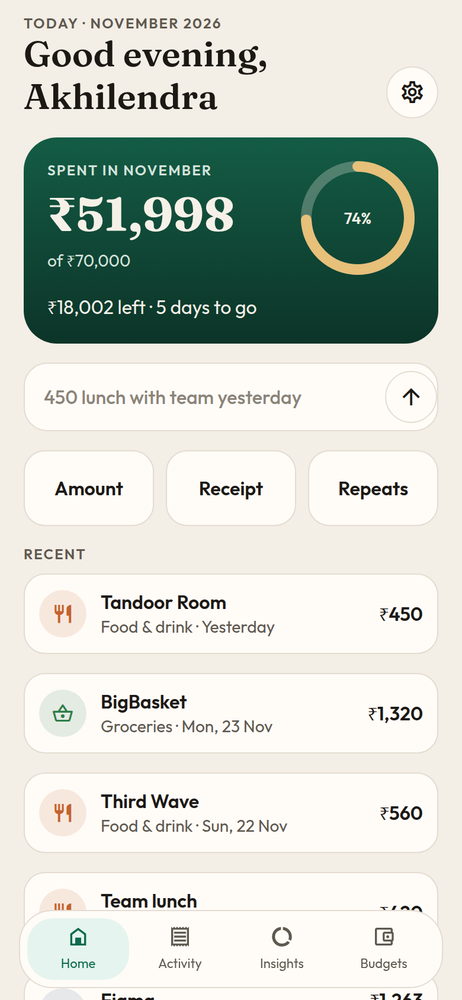
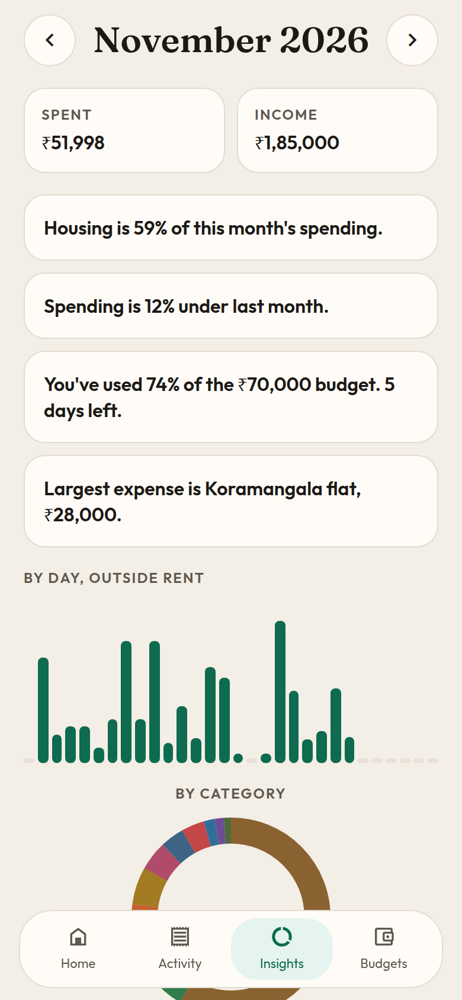
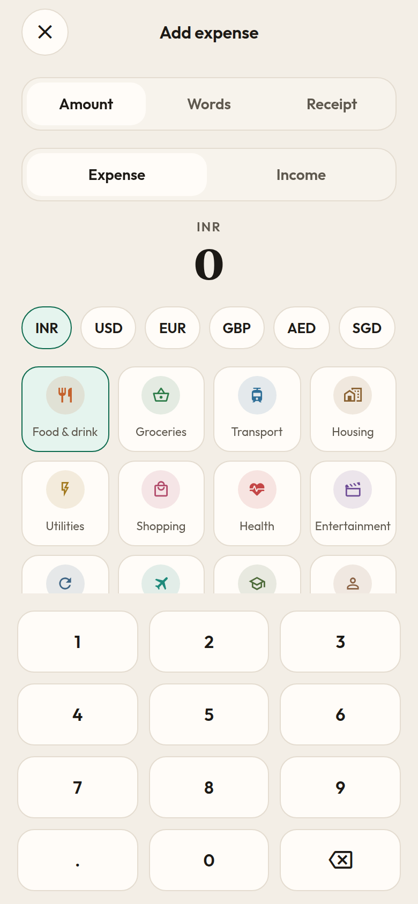
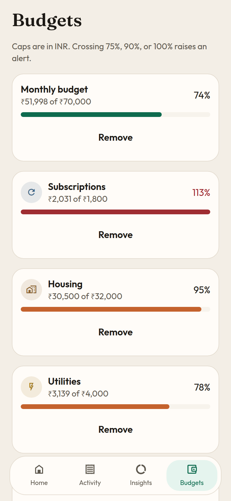
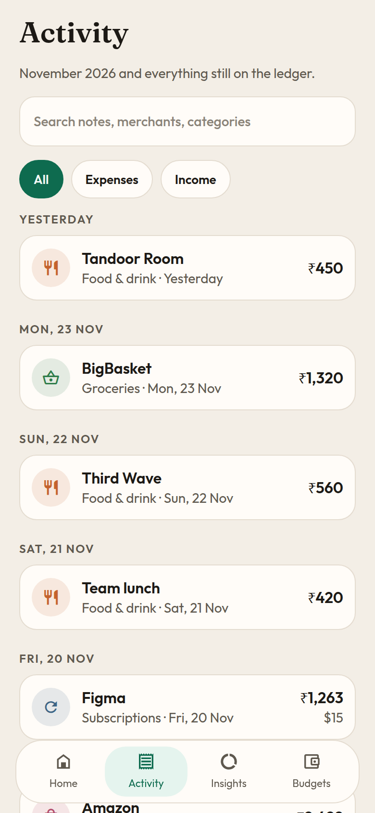
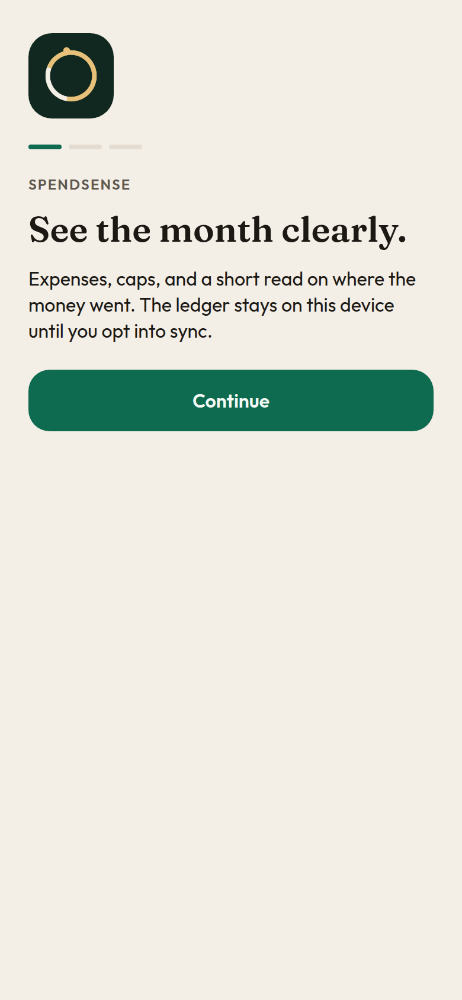
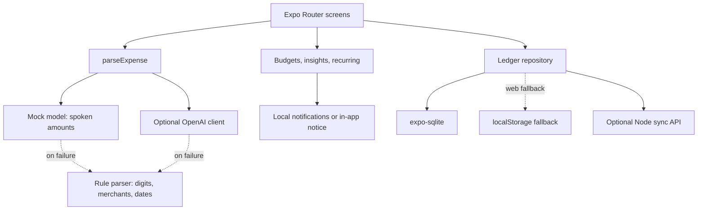

# SpendSense

A local-first expense ledger for the way people actually write money down: `450 lunch with team yesterday`.

SpendSense is a cross-platform Expo app — phone first, browser preview included — built as a portfolio piece by [Akhilendra Singh](https://github.com/AkhilSingh2). It runs in Expo Go and on the web with **zero API keys**. The on-device parser is a mock model with a rule-based fallback. Charts, budgets, and the ledger all work offline.

**Live demo:** [akhilsingh2.github.io/spendsense-mobile](https://akhilsingh2.github.io/spendsense-mobile/). This is the Expo web build in demo mode: pick the sample month during onboarding, and everything you enter stays in this browser.



## What you can do

- Add an expense from a sentence, a keypad, or a receipt photo. The sample receipt (`Tandoor Room`, ₹450) shows the review step without a camera.
- Track categories, income, and monthly caps. Crossing 75%, 90%, or 100% raises one alert, not three.
- Read the month: daily bars, a category donut, and sentences that compare this month with the last without pretending rent repeats every day.
- Keep repeats (rent, salary, Netflix). The next time you open the app, due items post themselves.
- Count in INR by default, and keep the original currency on a charge (`$15` Figma stays in dollars, totals convert with a bundled rate).
- Lock the ledger with a PIN. Biometrics are used when the device has them. Face ID inside Expo Go on iOS is not available; the PIN is.
- Stay on the device. SQLite is the store. If the browser cannot open SQLite, the same ledger falls back to local storage. Sync is optional.

## Screens

| Home | Insights | Add |
| --- | --- | --- |
|  |  |  |

| Budgets | Activity | Onboarding |
| --- | --- | --- |
|  |  |  |

A short walk through the same screens: [docs/screenshots/tour.gif](docs/screenshots/tour.gif).

Dark mode is in Settings → Appearance.

## Architecture



The parse pipeline tries the model first. With no key, that model is `MockLlmClient`: it rewrites “four hundred fifty” into digits, then uses the same grammar as the rules. If the model throws, `parseWithRules` still accepts `450 lunch yesterday`. Settings can force “Rules only” so the fallback is visible.

Money is stored as minor units (paise, cents). Budgets and charts convert into the home currency with rates labeled **indicative, November 2026**.

## Stack

- Expo SDK 58, React Native 0.88, React 19, TypeScript, Expo Router
- Reanimated 4 and Gesture Handler for press, progress, and swipe-to-reveal delete
- expo-sqlite, with a local snapshot fallback
- expo-notifications for local budget alerts (in-app notice on web)
- expo-local-authentication plus a salted SHA-256 PIN
- expo-image-picker for receipt photos
- Jest, React Native Testing Library, GitHub Actions
- A dependency-free Node sync server in `server/`

## What this demonstrates

- File-based navigation, modals, and tabs without a hand-written navigator
- A local-first write path: one snapshot, real SQL tables, an outbox, last-write-wins sync
- A model boundary you can ship without a key, and replace with a real model by setting an env var
- Motion that stays out of the way, and a design system (Fraunces + Outfit, paper and jade) rather than a default kit
- Platform splits: notifications, biometrics, and file export each have a `.web.ts` twin

## Run it

```bash
npm install
npm start          # Expo Go: scan the QR code
npm run web        # browser preview, no keys
```

On first launch, continue through the intro and leave **Load the sample month** on. That is a fictional Bengaluru month (rent, metro, Swiggy, a $15 Figma seat) so the charts are not empty. Erase it in Settings.

Try these lines on Home:

- `450 lunch with team yesterday`
- `₹1,200 uber to airport`
- `$15 figma today`
- `four hundred fifty coffee yesterday` (on-device model)
- `2.5k electricity bill`

Switch Settings → Parser to **Rules only** and try the spoken line again. Rules will ask for digits. `450 lunch yesterday` still saves.

```bash
npm test           # Jest
npm run test:server
npm run typecheck
npm run lint
npm run server     # optional sync on http://localhost:8787
```

Point Settings → Sync URL at `http://localhost:8787` and tap Sync now. Leave the token blank unless you set `SYNC_TOKEN`.

## Build and deploy

Store binaries are built with EAS. The profiles live in `eas.json`: `development` (dev client + iOS simulator), `preview` (internal Android APK), `production` (store, auto-increment).

```bash
npm install -g eas-cli
eas login
eas init          # writes the project id into app.json
eas build --profile preview --platform android
eas build --profile production --platform all
eas submit --profile production --platform ios
```

You need an Expo account for cloud builds, an Apple Developer account for TestFlight/App Store, and a Google Play Console account for Play. None of those are required to run the app in Expo Go or the browser.

`ios/` and `android/` are generated at build time. Change native config in `app.json`, not by editing those folders.

## Environment

Copy `.env.example` to `.env`. All values are optional.

| Variable | Purpose |
| --- | --- |
| `EXPO_PUBLIC_AI_MODE` | `mock` (default) or `openai` |
| `EXPO_PUBLIC_OPENAI_API_KEY` | Only used when mode is `openai` |
| `EXPO_PUBLIC_OPENAI_MODEL` | Default `gpt-4o-mini` |
| `EXPO_PUBLIC_OPENAI_BASE_URL` | OpenAI-compatible chat completions URL |
| `EXPO_PUBLIC_SYNC_URL` | Optional backup server |
| `EXPO_PUBLIC_SYNC_TOKEN` | Bearer token, if the server requires one |
| `PORT`, `SYNC_TOKEN` | Server only |

`.env` is gitignored. Do not commit keys.

## Project map

```
app/                 Expo Router screens
src/domain/          Money, budgets, insights, recurring, sync merge
src/parse/           Rules, spoken numbers, mock and OpenAI clients
src/data/            SQLite, local fallback, seed, React store
src/components/      Design-system primitives, charts, editor
server/              Optional sync API
docs/LEARNING.md     Study guide
```

## Accounts you do not need

The default app does not call OpenAI, Supabase, or a push provider. Receipt OCR is a labeled mock. Exchange rates are bundled. Local notifications on a real device need the normal OS permission prompt, not a server.

A real model, cloud sync, and store distribution are the only steps that need accounts. See [docs/LEARNING.md](docs/LEARNING.md) for how the pieces fit together and for exercises that extend them.
